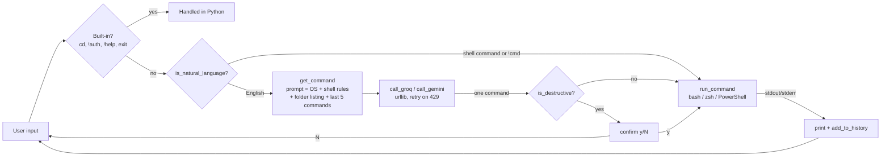

<div align="center">


**Talk to your terminal in plain English.**

[](LICENSE)
[](https://github.com/muhib-karim/OpenSH)
[](https://github.com/muhib-karim/OpenSH/actions/workflows/ci.yml)
[](https://github.com/muhib-karim/OpenSH/releases/latest)
[](https://opensh.vercel.app)

**[Features](#features)** · **[Quick start](#quick-start)** · **[Usage](#usage)** · **[Safety](#safety)** · **[Architecture](#architecture)** · **[Testing](#testing)** · **[Limitations](#limitations-and-roadmap)**

</div>

## What it is

**OpenSH** (`opsh`) is a natural-language shell. You type what you want, a large language model (Groq or Google Gemini, using your own API key) turns it into one command for your OS and shell (PowerShell on Windows, Bash/Zsh on macOS and Linux), OpenSH prints it, and then runs it. Commands that could destroy data or shut the machine down are held back until you confirm them.

```text
~/projects > find all video files over 1GB in my downloads folder
→ find ~/Downloads -type f \( -name "*.mp4" -o -name "*.mov" -o -name "*.mkv" \) -size +1G
```

Plain shell commands (`ls`, `git status`, `Get-Process`, …) skip the model and run directly, so you can use it as your everyday shell.

It is a single Python file that uses only the standard library. Provider calls go through `urllib`, so there is no SDK to install.

### Why it is built this way

- **Low friction.** One Python file, standard library only, bring your own Groq or Gemini key. Nothing else to install or host.
- **Fast for everyday use.** Ordinary shell input is detected locally and never sent to the model.
- **A check before risky commands run.** Generated commands pass a regex-based destructive-command guard with its own test suite, and anything it flags needs an explicit `y`.

## Features

| | |
| :--- | :--- |
| **Plain English to command** | Describe the task and get one command for your platform (`opsh.py: get_command`). |
| **Shell-vs-English classifier** | Known commands and prefixes (`git `, `docker `, `Get-`, `./`, pipes, …) run as typed, with no API call (`is_natural_language`). |
| **Safety guard** | 26 regex patterns catch recursive deletes, disk formatting, `dd`, shutdown/reboot, force-push and hard reset, `curl \| bash`, `DROP TABLE` and more. Matching commands need an explicit `y` (`is_destructive`, `confirm_if_destructive`). |
| **Context-aware prompts** | The prompt includes the current folder listing, Desktop listing and the last 5 commands with trimmed output, so "open the resume folder" resolves to `Current Resume`. |
| **Two providers** | Groq (`llama-3.3-70b-versatile`) or Gemini (`gemini-2.0-flash`), with automatic retry and backoff on HTTP 429. |
| **Cross-platform** | Windows (PowerShell, `pyreadline3` optional), macOS and Linux. |
| **Installers and binaries** | `install.sh` / `install.ps1` set up `~/.opsh`. The release workflow builds PyInstaller binaries for all 3 OSes on every `v*` tag. |

### Demo

Real output from this repository (`--version`, `--help` and the test suite):


## Quick start

**Windows (PowerShell)**
```powershell
irm https://raw.githubusercontent.com/muhib-karim/OpenSH/main/install.ps1 | iex
```

**macOS / Linux**
```bash
curl -fsSL https://raw.githubusercontent.com/muhib-karim/OpenSH/main/install.sh | bash
```

The installer puts OpenSH in `~/.opsh/` and adds the `opsh` command to your PATH. You can also download a standalone binary from the [latest release](https://github.com/muhib-karim/OpenSH/releases/latest), or run it from source:

```bash
git clone https://github.com/muhib-karim/OpenSH && cd OpenSH
python opsh.py            # Python 3.9+; no third-party packages needed
```

On first run OpenSH asks you to pick a provider and paste an API key ([Groq](https://console.groq.com/keys) or [Gemini](https://aistudio.google.com/apikey)).

To uninstall, run `!uninstall` inside OpenSH, or use `uninstall.sh` / `uninstall.ps1`.

## Usage

```bash
opsh                                  # interactive shell
opsh -c "show my public ip address"   # one request, then exit
opsh -y -c "delete the build folder"  # skip the safety prompt (careful)
opsh --version
opsh --help
```

Inside the interactive shell:

| Input | What happens |
| :--- | :--- |
| `compress the logs folder into a zip` | Sent to the model; the command is shown, then run. |
| `git status`, `ls -la`, `Get-Process` | Recognised as a shell command and run as-is. |
| `!<command>` | Run a raw command without the model, e.g. `!echo hello`. |
| `cd <path>` | Changes directory. This also works when the model returns `cd`, `Set-Location` or `chdir`. |
| `!auth` | Switch provider or replace the API key. |
| `!version` · `!help` · `!credits` | Info. |
| `!uninstall` | Remove OpenSH. |
| `exit` (or Ctrl+D; Ctrl+C on Windows) | Quit and print a session summary (duration and number of commands). On macOS/Linux, Ctrl+C cancels the current line. |

## Safety

Generated commands run automatically **unless** they match the destructive-command guard, which covers:

- recursive or forced deletes: `rm -rf`, `rm -r`, `del /s`, `rd /s`, `Remove-Item -Recurse/-Force`
- disk-level writes: `mkfs`, `format X:`, `diskpart`, `dd of=…`, redirects into `/dev/sd*`
- power: `shutdown`, `reboot`, `halt`, `Stop-Computer`, `Restart-Computer`
- history rewrites: `git push --force`, `git reset --hard`, `git clean -f`
- blanket permission changes on `/`, `killall`, forced `Stop-Process`, fork bombs
- piping a download into a shell: `curl … | bash`, `iwr … | iex`
- SQL `DROP TABLE/DATABASE`, `TRUNCATE TABLE`

Matching commands are printed in red with a `[y/N]` prompt; any answer other than `y`/`yes` (including Ctrl+D) skips them. `-y/--yes` turns the prompt off for scripted use. The patterns live in `opsh.py` (`_DESTRUCTIVE_PATTERNS`) and have both positive and negative test cases in `tests/test_safety.py`.

The guard is a seatbelt, not a sandbox. Read the `→` line before trusting a command in an unfamiliar folder. Commands you type yourself (not generated) run as typed.

## Configuration

OpenSH keeps its settings next to the program (`~/.opsh/` after a normal install). Both files are git-ignored.

| File | Contents |
| :--- | :--- |
| `config.json` | `{"provider": "groq"}` or `{"provider": "gemini"}` |
| `.env` | `GROQ_API_KEY=…` and/or `GEMINI_API_KEY=…` |

`!auth` rewrites both. Your key is only sent to the provider you chose. On interactive start, OpenSH also makes one anonymous request to the GitHub Releases API to check for a newer version.

## Architecture



- **`opsh.py`**: the whole CLI. It handles platform detection, the shell-vs-English classifier, prompt building, provider calls with rate-limit retry, the safety guard, history (capped at 10 entries / 4000 chars), config and `.env` handling, the update check, and the REPL.
- **`install.sh` / `install.ps1`** and the uninstallers: set up `~/.opsh/` (with a virtualenv) and the `opsh` command.
- **`.github/workflows/ci.yml`**: syntax check, version check and unit tests on Ubuntu, Windows and macOS × Python 3.9, 3.11 and 3.12, plus a ruff lint job.
- **`.github/workflows/release.yml`**: on a `v*` tag, builds PyInstaller binaries on all 3 OSes and publishes them as a GitHub Release.
- **`docs/`**: banner, demo image and the static landing page (deployed to [opensh.vercel.app](https://opensh.vercel.app) via `vercel.json`).

## Testing

```bash
python -m pip install -r requirements.txt pytest
python -m pytest -q tests                        # 70 tests
python -m py_compile opsh.py
python opsh.py --version
python -m pip install ruff
ruff check --select E9,F63,F7,F82 opsh.py tests  # syntax errors / undefined names
```

The suite needs no network access or API key. Provider HTTP calls are mocked, and config, `.env` and the home folder are redirected to a temp directory.

- `tests/test_safety.py`: 30 cases. Destructive commands must be flagged and everyday commands (`git push origin main`, `rmdir empty_dir`, `cat format.txt`) must not be.
- `tests/test_core.py`: 40 cases covering version comparison, the shell-vs-English classifier (Linux and Windows), history capping and formatting, the `!help` exit key per platform, the confirmation prompt, config and `.env` round-trips, prompt contents, Groq/Gemini response parsing and 429 retry, `run_command`, and a `--help` / `--version` CLI smoke test.

## Project structure

```text
OpenSH/
├── opsh.py                  # the CLI (single file, stdlib only)
├── tests/
│   ├── test_safety.py       # destructive-command guard
│   └── test_core.py         # classifier, history, config, prompt, providers, CLI
├── install.sh / install.ps1 # installers (~/.opsh + PATH)
├── uninstall.sh / uninstall.ps1
├── requirements.txt         # only pyreadline3 on Windows (optional)
├── docs/
│   ├── banner.svg, demo.svg
│   ├── assets/              # logo.svg, banner.svg
│   └── index.html           # landing page
├── vercel.json              # static hosting config for docs/
├── .github/workflows/       # ci.yml, release.yml
└── CHANGELOG.md · CREDITS.md · LICENSE
```

## Limitations and roadmap

- The model's output is executed after a regex check, not in a sandbox. The guard lowers the risk but cannot prove a command is safe.
- Non-destructive generated commands run without a preview pause. Use `-c` in a scratch folder if you want to experiment.
- On Linux and macOS, commands run without a timeout so that interactive tools keep working. On Windows there is a 60 s timeout.
- Model names (`llama-3.3-70b-versatile`, `gemini-2.0-flash`) are hard-coded. Planned (see [CHANGELOG](CHANGELOG.md)): configurable model selection and command aliases.

## Contributing

Issues and PRs are welcome. Please add a test in `tests/` for anything that touches the safety guard or the classifier.

## License

MIT, see [LICENSE](LICENSE). Based on [nlsh](https://github.com/junaid-mahmood/nlsh) by Junaid Mahmood; see [CREDITS.md](CREDITS.md). If OpenSH is useful to you, you can support it on [Ko-fi](https://ko-fi.com/ai_dev_2024).
