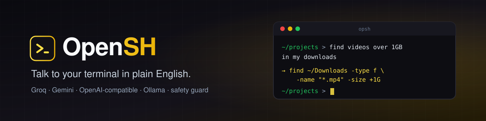
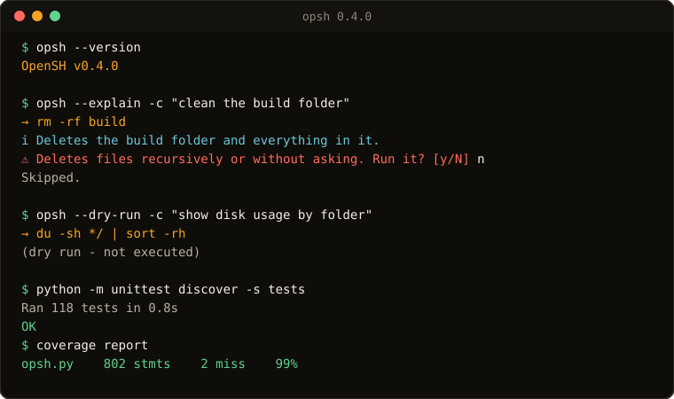
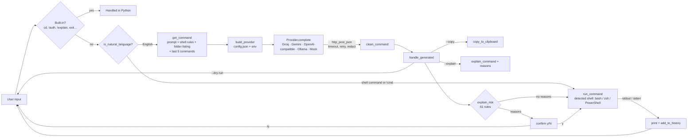

<div align="center">



**Say what you want. Read it. Then run it.**

[](https://github.com/muhib-karim/OpenSH/actions/workflows/ci.yml)
[](https://github.com/muhib-karim/OpenSH/actions/workflows/codeql.yml)
[](https://github.com/muhib-karim/OpenSH/releases/latest)
[](#install)
[](opsh.py)
[](#development)
[](LICENSE)
[](https://opensh.vercel.app)

**[Install](#install)** · **[Usage](#usage)** · **[Safety](#safety)** · **[Providers](#providers-and-configuration)** · **[Architecture](#architecture)** · **[Development](#development)**

</div>

## What it is

**OpenSH** (`opsh`) is a natural-language shell. You type what you want; a language model of your choice turns it into one command for your shell (PowerShell, bash or zsh); OpenSH prints it, checks it against a safety guard, and runs it. Anything that could destroy data, take the machine down or run code straight from the internet is held back until you type `y`.

```text
~/projects > find all video files over 1GB in my downloads
→ find ~/Downloads -type f \( -name "*.mp4" -o -name "*.mov" -o -name "*.mkv" \) -size +1G
```

Plain shell input (`ls`, `git status`, `Get-Process`, …) is recognised locally and runs without calling the model, so you can use it as your everyday shell.

It is **one Python file that uses only the standard library**. Provider calls go through `urllib`; there is no SDK to install.



<sub>Example session. Model answers vary; the guard prompt, flags and test results are real output.</sub>

## What's new in 0.4.0

- **Safety guard rebuilt**: 61 rules with a plain-English reason each, matched where a command actually starts, across bash, zsh, PowerShell and cmd; 135 destructive/benign test pairs.
- **Explain before run** (`--explain`, `!explain`), **dry run** (`--dry-run`), **copy to clipboard** (`--copy`).
- **Any model**: Groq, Gemini, any OpenAI-compatible endpoint, local Ollama, and an offline mock provider. Timeouts, retries and `Retry-After`; keys never printed.
- **Shell auto-detect**, persistent **history file**, `--help` examples and a **man page**.
- **CI gates**: ruff, mypy, 118 unittest tests at 99% coverage on Linux/macOS/Windows, gitleaks, CodeQL, Dependabot; release binaries are smoke-tested before publishing.

See the [CHANGELOG](CHANGELOG.md) for the full list.

## Install

Needs Python 3.10 or newer (except for the standalone binaries).

**Windows** (PowerShell)
```powershell
irm https://raw.githubusercontent.com/muhib-karim/OpenSH/main/install.ps1 | iex
```
Optional: `pip install pyreadline3` for arrow-key history.

**macOS** (zsh by default)
```bash
curl -fsSL https://raw.githubusercontent.com/muhib-karim/OpenSH/main/install.sh | bash
```

**Linux**
```bash
curl -fsSL https://raw.githubusercontent.com/muhib-karim/OpenSH/main/install.sh | bash
```
For `--copy`, install `wl-copy` (Wayland), `xclip` or `xsel`.

The installers put OpenSH in `~/.opsh/` and add the `opsh` command to your PATH. Prefer to read before you run? Download `install.sh` / `install.ps1` first, or use one of these:

- **Standalone binary**: `opsh-windows.zip`, `opsh-linux.tar.gz` or `opsh-macos.tar.gz` from the [latest release](https://github.com/muhib-karim/OpenSH/releases/latest), with `SHA256SUMS.txt` to verify them.
- **From source**:
  ```bash
  git clone https://github.com/muhib-karim/OpenSH && cd OpenSH
  python opsh.py
  ```

On first run OpenSH asks you to pick a provider. To uninstall, run `!uninstall` inside OpenSH, or use `uninstall.sh` / `uninstall.ps1`.

## Usage

```bash
opsh                                      # interactive shell
opsh -c "show my public ip address"       # one request, then exit
opsh -n -c "delete all .tmp files"        # dry run: print the command, run nothing
opsh -e -c "free up disk space"           # explain the command, then ask before running it
opsh --copy -n -c "find big files"        # copy the command to the clipboard
opsh --provider ollama --model llama3.2   # use a local model for this session
OPENSH_PROVIDER=mock opsh -n -c "list files"   # offline demo, no key needed
```

| Flag | Effect |
| :--- | :--- |
| `-c`, `--command TEXT…` | Handle one request and exit. |
| `-n`, `--dry-run` | Show generated commands, never run them. |
| `-e`, `--explain` | Explain each command (and why the guard flagged it), then ask. |
| `-y`, `--yes` | Run flagged commands without asking. Use with care. |
| `--copy` | Copy each generated command to the clipboard. |
| `--shell bash\|zsh\|powershell` | Override shell auto-detection. |
| `--provider NAME`, `--model NAME` | Provider/model for this session only. |
| `--no-history` | Don't read or write the history file. |

Inside the interactive shell:

| Input | What happens |
| :--- | :--- |
| `compress the logs folder into a zip` | Sent to the model; the command is shown, checked, then run. |
| `git status`, `ls -la`, `Get-Process` | Recognised as a shell command and run as typed. |
| `!<command>` | Run a raw command without the model, e.g. `!echo hello`. |
| `cd <path>` | Changes directory, also when the model returns `cd`, `Set-Location` or `chdir`. |
| `!explain` · `!dry-run` | Toggle explain-before-run or dry run. |
| `!copy` | Copy the last generated command. |
| `!history` | Show recent input. |
| `!auth` | Switch provider or replace the API key. |
| `!version` · `!help` · `!credits` · `!uninstall` | Info and removal. |
| `exit` (or Ctrl+D; Ctrl+C on Windows) | Quit with a session summary. On macOS/Linux, Ctrl+C cancels the current line. |

`man docs/opsh.1` has the full reference.

## Safety

Every generated command is checked by `explain_risk()` before it runs. Rules match where a command actually starts (start of line, after `;` `&&` `||` `|`, inside `$(…)`, behind `sudo`, `xargs`, `find -exec`, `nohup` and friends), so `cat shutdown.log` and `echo reboot` pass while `sudo shutdown -h now` does not.

| Category | Held for a `y` | Runs straight away |
| :--- | :--- | :--- |
| Recursive / forced delete | `rm -rf build`, `sudo rm -r ~/old`, `find . -delete`, `shred -u x` | `rm build.log`, `find . -name '*.log'` |
| PowerShell / cmd delete | `Remove-Item C:\temp -Recurse`, `ri .\build -r -fo`, `rmdir /s /q C:\old`, `del /s /q *.log` | `Remove-Item C:\temp\a.txt`, `rmdir C:\empty` |
| Disks and filesystems | `mkfs.ext4 /dev/sdb1`, `dd if=x.iso of=/dev/sdb`, `> /dev/nvme0n1`, `Format-Volume`, `format D:`, `diskutil eraseDisk …` | `lsblk`, `dd if=/dev/sda of=backup.img`, `fdisk -l` |
| Permissions | `chmod -R 777 /`, `chown -R me /usr`, `icacls C:\ /grant Everyone:F` | `chmod -R 755 ./dist`, `chmod 777 /tmp/test.sock` |
| Fork bombs, mass kills | `:(){ :\|:& };:`, `%0\|%0`, `kill -9 -1`, `killall node`, `Stop-Process -Force`, `taskkill /f` | `kill -9 12345`, `pkill -f my_script.py` |
| Power | `shutdown -h now`, `sudo reboot`, `systemctl poweroff`, `Restart-Computer` | `cat shutdown.log`, `systemctl status nginx` |
| Git history | `git push --force`, `git push origin +main`, `git reset --hard`, `git clean -fdx`, `git branch -D x` | `git push origin main`, `git reset --soft HEAD~1`, `git clean -n` |
| Download and run | `curl … \| bash`, `wget -qO- … \| sh`, `bash <(curl …)`, `iwr … \| iex`, `iex (…).DownloadString(…)` | `curl … \| jq .`, `iwr … -OutFile x.ps1` |
| System files and security | `> /etc/passwd`, `crontab -r`, `reg delete HKLM\…`, `Set-ExecutionPolicy Unrestricted`, `Set-MpPreference -Disable… $true` | `cat /etc/passwd`, `crontab -l`, `Get-ExecutionPolicy` |
| Data and infrastructure | `DROP TABLE`, `TRUNCATE TABLE`, `redis-cli FLUSHALL`, `docker system prune`, `kubectl delete`, `terraform destroy` | `SELECT …`, `docker ps -a`, `terraform plan` |

A flagged command is printed with the reason, e.g. `⚠ Deletes files recursively or without asking. Run it? [y/N]`. Anything other than `y`/`yes` (including Ctrl+D or a closed stdin) skips it. `-y/--yes` turns the prompt off for scripted use. With `--explain`, every command (flagged or not) is explained first and needs a confirmation.

The rules live in `GUARD_RULES` in `opsh.py`. `tests/test_safety.py` pairs each destructive command with a similar everyday one (135 pairs: 79 bash, 12 zsh, 30 PowerShell, 14 cmd), so a rule that is too broad fails as loudly as one that is too narrow.

The guard is a seatbelt, not a sandbox: it lowers the risk but cannot prove a command is safe. Commands you type yourself run as typed.

## Providers and configuration

| Provider | Key | Default model | Notes |
| :--- | :--- | :--- | :--- |
| `groq` (default) | `GROQ_API_KEY` | `llama-3.3-70b-versatile` | Fast free tier. [Get a key](https://console.groq.com/keys). |
| `gemini` | `GEMINI_API_KEY` | `gemini-2.5-flash` | [Get a key](https://aistudio.google.com/apikey). Key is sent in a header, never in the URL. |
| `openai` | `OPENAI_API_KEY` (or `api_key_env`) | `gpt-4o-mini` | Any OpenAI-compatible `/chat/completions` URL: OpenAI, OpenRouter, LM Studio, vLLM, … |
| `ollama` | none | `llama3.2` | Local models; uses `OLLAMA_HOST` or `http://localhost:11434`. Nothing leaves your machine. |
| `mock` | none | `mock` | Offline and deterministic, for tests and demos. |

Settings live next to the program (`~/.opsh/` after an install); both files are git-ignored. `!auth` writes them for you.

| File | Contents |
| :--- | :--- |
| `config.json` | `provider`, and optionally `model`, `base_url`, `api_key_env`, `timeout` (seconds, default 30), `retries` (default 2), `history` (`false` to turn the history file off). |
| `.env` | API keys, e.g. `GROQ_API_KEY=…`. Written with mode 600 on macOS/Linux. Variables already set in your environment win. |
| `history` | Your input, at most 1000 lines. Lines that look like keys or passwords are never saved. |

A custom OpenAI-compatible endpoint:

```json
{
  "provider": "openai",
  "base_url": "https://openrouter.ai/api/v1",
  "model": "meta-llama/llama-3.3-70b-instruct",
  "api_key_env": "OPENROUTER_API_KEY",
  "timeout": 20
}
```

Environment overrides for a single run: `OPENSH_PROVIDER`, `OPENSH_MODEL`, `OPENSH_BASE_URL`, `OPENSH_TIMEOUT`, `OPENSH_SHELL`, `OPENSH_HISTORY`, `OPENSH_NO_UPDATE_CHECK`, and `OPENSH_MOCK_RESPONSE` for the mock provider.

Keys are only read from the environment or `.env`. They are never printed, `repr()` of a provider hides them, and they are scrubbed from error messages. Requests time out (30 s by default) and retry with backoff on HTTP 429/5xx and network errors, honouring `Retry-After`. On interactive start OpenSH makes one anonymous request to the GitHub Releases API to check for a newer version (`OPENSH_NO_UPDATE_CHECK=1` turns it off).

## Architecture



`opsh.py` is organised in sections: platform and shell detection, update check, settings (`config.json`, `.env`), providers (`Provider` and subclasses, `http_post_json`, `build_provider`), first-run setup, prompt context and the history file, prompt building, the shell-vs-English classifier, the safety guard, clipboard, running commands, and the CLI/REPL.

## Development

```bash
python -m unittest discover -s tests          # 118 tests, stdlib only, no network or key
python -m pip install "coverage[toml]" ruff mypy
python -m coverage run -m unittest discover -s tests && python -m coverage report   # fails under 85%
ruff check .
mypy
```

The suite is stdlib `unittest`. Every test runs against a temporary config, `.env`, history file and home folder; any real network call fails the test. Provider HTTP is faked at `urlopen`, and an end-to-end test runs the real script with the offline provider.

| File | Covers |
| :--- | :--- |
| `tests/test_safety.py` | The guard table (135 pairs), reasons, and the confirmation prompt. |
| `tests/test_providers.py` | HTTP retries/backoff/`Retry-After`, key redaction, each provider's request and response shape, `build_provider`. |
| `tests/test_core.py` | Classifier, shell detection, history and history file, settings, prompt building, clipboard, `cd`, `run_command`. |
| `tests/test_cli.py` | Explain/dry-run/copy flow, first-run setup for every provider, REPL built-ins, update check, uninstall, flags, end-to-end runs. |

CI (`.github/workflows/`): **ci.yml** runs ruff, mypy, and the suite under coverage on Ubuntu, macOS and Windows × Python 3.10, 3.12 and 3.13, plus a gitleaks secret scan. **codeql.yml** runs CodeQL. **release.yml** runs on a `v*` tag: tests, PyInstaller binaries for all three OSes, a smoke test of each binary, `SHA256SUMS.txt`, GitHub Release. Dependabot keeps actions and pip pins current.

## Project structure

```text
OpenSH/
├── opsh.py                   # the CLI (single file, stdlib only)
├── tests/                    # unittest suite (support.py holds the isolation base class)
├── install.sh / install.ps1  # installers (~/.opsh + PATH)
├── uninstall.sh / uninstall.ps1
├── pyproject.toml            # ruff, mypy and coverage settings (nothing to build)
├── requirements.txt          # only pyreadline3 on Windows (optional)
├── docs/
│   ├── opsh.1                # man page
│   ├── index.html            # landing page (opensh.vercel.app)
│   ├── banner.svg, demo.svg, assets/
│   └── PROJECT_BRAIN.md      # handoff notes for maintainers
├── .github/                  # CI, CodeQL, release, Dependabot
└── CHANGELOG.md · HANDOFF.md · TASKS.md · SKILLS_USED.md · CREDITS.md · LICENSE
```

## Limitations and roadmap

- The model's output runs after a rule check, not in a sandbox. Use `--explain` or `--dry-run` when you are somewhere that matters.
- Output is captured, so full-screen tools (`vim`, `top`) work best through `!` or your normal terminal.
- On Linux and macOS commands run without a timeout so long jobs finish; on Windows there is a 60 s timeout.
- Planned: command aliases, per-folder context hints.

## Contributing

Issues and PRs are welcome. Anything that touches the safety guard needs a destructive and a benign row in `tests/test_safety.py`.

## License

MIT, see [LICENSE](LICENSE). Based on [nlsh](https://github.com/junaid-mahmood/nlsh) by Junaid Mahmood; see [CREDITS.md](CREDITS.md). If OpenSH is useful to you, you can support it on [Ko-fi](https://ko-fi.com/ai_dev_2024).
