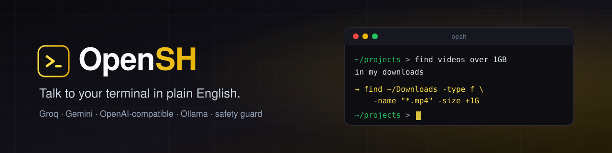
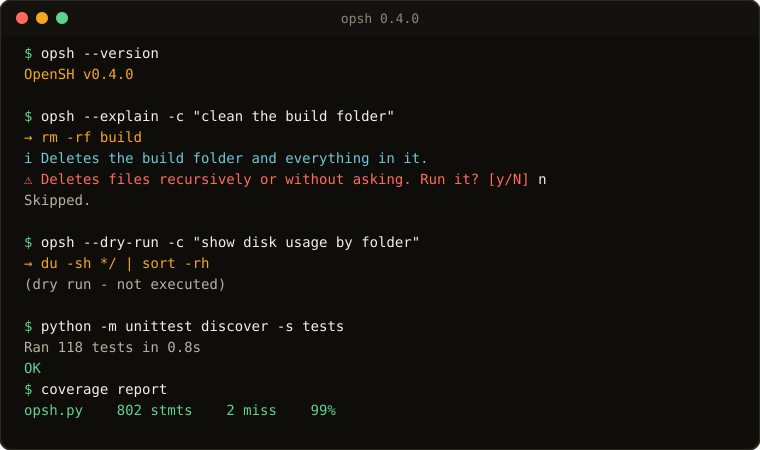
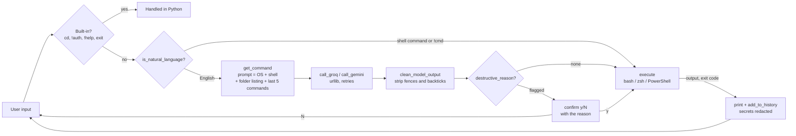

<div align="center">



**Talk to your terminal in plain English.**

[](https://github.com/muhib-karim/OpenSH/actions/workflows/ci.yml)
[](https://github.com/muhib-karim/OpenSH/releases/latest)
[](https://github.com/muhib-karim/OpenSH/blob/main/.github/workflows/ci.yml)
[](https://github.com/muhib-karim/OpenSH/releases/latest)
[](https://github.com/muhib-karim/OpenSH/blob/main/LICENSE)
[](https://opensh.vercel.app)

**[Quick start](#quick-start)** · **[Usage](#usage)** · **[Safety](#safety)** · **[Configuration](#configuration)** · **[Architecture](#architecture)** · **[Testing](#testing)** · **[Limitations](#limitations-and-roadmap)**

</div>

## What it is

**OpenSH** (`opsh`) is a natural-language shell. You type what you want, a large language model (Groq or Google Gemini, using your own API key) turns it into one command for your OS and shell (PowerShell on Windows, zsh on macOS, bash on Linux), OpenSH prints it, and then runs it. Commands that could destroy data or shut the machine down are held back until you confirm them.

```text
~/projects > find all video files over 1GB in my downloads folder
→ find ~/Downloads -type f \( -name "*.mp4" -o -name "*.mov" -o -name "*.mkv" \) -size +1G
```

Plain shell commands (`ls`, `git status`, `Get-Process`, …) skip the model and run directly, so you can use it as your everyday shell.

It is a single Python file that uses only the standard library. Provider calls go through `urllib`, so there is no SDK to install.

### Why it is built this way

- **Low friction.** One Python file, standard library only, bring your own Groq or Gemini key. Nothing else to install or host.
- **Fast for everyday use.** Ordinary shell input is detected locally and never sent to the model.
- **A check before risky commands run.** Generated commands pass a destructive-command guard with its own test suite, and anything it flags needs an explicit `y`.

## Features

| | |
| :--- | :--- |
| **Plain English to command** | Describe the task and get one command for your platform (`get_command`). Markdown fences and backticks in the model's reply are stripped before anything runs (`clean_model_output`). |
| **Shell-vs-English classifier** | Known commands and prefixes (`git `, `docker `, `Get-`, `./`, pipes, …) run as typed, with no API call. Sentences that merely start with a command word ("open the resume folder") still go to the model (`is_natural_language`). |
| **Safety guard** | Recursive and wildcard deletes, disk tools, `dd`, shutdown, history rewrites, downloads piped into a shell, obfuscated commands and more need an explicit `y`, and the prompt says why (`destructive_reason`, `confirm_if_destructive`). |
| **Context-aware prompts** | The prompt includes the current folder listing, Desktop listing and the last 5 commands with trimmed output, so "open the resume folder" resolves to `Current Resume`. |
| **Two providers, your choice of model** | Groq or Gemini, with retry and backoff on rate limits, server errors and timeouts. The model is configurable, so a provider retiring one does not need a new release. |
| **Cross-platform** | Windows (PowerShell, `pyreadline3` optional), macOS and Linux. CI runs the tests on all three with Python 3.9 to 3.13. |
| **Installers and binaries** | `install.sh` / `install.ps1` set up `~/.opsh`. The release workflow builds PyInstaller binaries for all 3 OSes on every `v*` tag and publishes checksums. |

### Demo



Captured at v0.3.0; the version and test count have grown since.

## Quick start

**macOS / Linux** (needs Python 3.9+ and git)
```bash
curl -fsSL https://raw.githubusercontent.com/muhib-karim/OpenSH/main/install.sh | bash
```

**Windows (PowerShell)** (needs Python 3.9+ and git)
```powershell
irm https://raw.githubusercontent.com/muhib-karim/OpenSH/main/install.ps1 | iex
```

The installer puts OpenSH in `~/.opsh/` and adds the `opsh` command to your PATH. If you would rather read a script before running it, download it first and run it from the file; both forms work.

Other ways to get it:

- **Standalone binary.** Download the archive for your OS from the [latest release](https://github.com/muhib-karim/OpenSH/releases/latest), check it against `SHA256SUMS`, and put `opsh` (or `opsh.exe`) somewhere on your PATH. No Python needed. Settings are stored in `~/.opsh/`.
- **From source.**
  ```bash
  git clone https://github.com/muhib-karim/OpenSH && cd OpenSH
  python opsh.py            # Python 3.9+; no third-party packages needed
  ```

On first run OpenSH asks you to pick a provider and paste an API key ([Groq](https://console.groq.com/keys) or [Gemini](https://aistudio.google.com/apikey)). If `GROQ_API_KEY` or `GEMINI_API_KEY` is already exported, it skips setup and uses that.

To uninstall, run `!uninstall` inside OpenSH, or use `uninstall.sh` / `uninstall.ps1`.

## Usage

```bash
opsh                                  # interactive shell
opsh -c "show my public ip address"   # one request, then exit
opsh -y -c "delete the build folder"  # skip the safety prompt (careful)
opsh --version
opsh --help
```

Inside the interactive shell:

| Input | What happens |
| :--- | :--- |
| `compress the logs folder into a zip` | Sent to the model; the command is shown, then run. |
| `git status`, `ls -la`, `Get-Process` | Recognised as a shell command and run as-is. |
| `!<command>` | Run a raw command without the model, e.g. `!echo hello`. |
| `cd <path>`, `cd ..`, `cd -`, `cd` | Changes directory. Also works for `chdir` and `Set-Location`, and when the model returns one of them. |
| `!auth` | Switch provider or replace the API key. |
| `!version` · `!help` · `!credits` | Info. `!version` also shows the model and the config folder in use. |
| `!uninstall` | Remove OpenSH. |
| `exit` (or Ctrl+D; Ctrl+C on Windows) | Quit and print a session summary. On macOS/Linux, Ctrl+C cancels the current line. |

`opsh -c` is built for scripts. Its exit status is:

| Status | Meaning |
| :--- | :--- |
| the command's own | The generated command ran; this is what it returned. |
| `1` | OpenSH could not get a command (provider, network or setup problem), or a flagged command was declined. |
| `2` | Bad arguments, such as `-c` with no request. |
| `130` | Interrupted with Ctrl+C. |

When output is piped or redirected, or `NO_COLOR` is set, colour codes and the "thinking" indicator are left out.

## Safety

Generated commands run automatically **unless** the guard flags them. Flagged commands are shown with the reason and a `[y/N]` prompt; anything other than `y`/`yes` (including Ctrl+D, or no terminal to ask on) skips them. `-y/--yes` turns the prompt off for scripted use.

**What is flagged**

- Deletes that are recursive, forced, wildcard or piped: `rm -rf`, `rm *`, `xargs rm`, `find -delete`, `Remove-Item -Recurse`, `del /s`, `rd /s`, and their aliases and abbreviations.
- Wipes and overwrites: `shred`, `truncate -s 0`, `rsync --delete`, `mv … /dev/null`, writes into `/etc`, `Clear-Content`.
- Disks and filesystems: `mkfs`, `dd of=`, `wipefs`, `fdisk`, `parted`, `diskutil erase…`, `format X:`, `Format-Volume`, writes to block devices.
- Recursive permission or ownership changes, and any `chmod`/`chown` on `/`.
- Power and processes: `shutdown`, `reboot`, `init 0`, `Stop-Computer`, `killall`, `pkill`, `kill -9 -1`, forced `Stop-Process`, fork bombs.
- Git data loss: `push --force`, `push --delete`, `reset --hard`, `clean -f`, `checkout .`, `restore .`, `branch -D`, `stash clear`.
- Databases and infrastructure: `DROP`, `TRUNCATE`, `DELETE FROM`, `dropdb`, `FLUSHALL`, `docker … prune`, `kubectl delete`, `terraform destroy`.
- Running code the guard cannot read: a download piped into a shell or interpreter, `bash <(curl …)`, download-then-run on one line, `eval`, `iex`, encoded PowerShell, a variable or substitution used as the command, interpreter one-liners that delete.

Before matching, a command is normalised: quotes, backslashes, backticks, `$IFS`, line continuations, Unicode dashes and smart quotes are resolved, so `r\m -rf /`, `"rm" -rf /` and `rm${IFS}-rf` are all seen as `rm -rf`. Control characters in a generated command are shown escaped, so they cannot hide what will run.

The rules live in `opsh.py` (`_GUARD_RULES`). `tests/test_guard_bypasses.py` holds one test per bypass found in the 0.4.0 audit and one per everyday command that must stay unprompted.

**What is not covered**

- The guard is a seatbelt, not a sandbox. It is a list of patterns over text, and a determined or unlucky command can still get past it. Read the `→` line before trusting a command in a folder you care about.
- Single-file deletes such as `rm notes.txt` run without a prompt. Only recursive, forced, wildcard and piped deletes are flagged.
- Commands you type yourself, including `!<command>`, are never checked. The guard is for what the model writes.

**What is sent to the provider**

Each request sends your sentence, the current folder path, up to 20 file names from the current folder and from your Desktop, and the last 5 commands with the first two lines of their output. API keys and `KEY=value` style credentials in that output are replaced with `[redacted]` first. Your API key goes only to the provider you chose. File names can steer the model like any other text, which is one more reason the guard exists.

## Configuration

Settings live in one folder:

| How you run it | Folder |
| :--- | :--- |
| Installed with `install.sh` / `install.ps1` | `~/.opsh/` |
| Standalone binary | `~/.opsh/` |
| From a source checkout | next to `opsh.py` (both files are git-ignored) |
| `OPSH_HOME` is set | that folder |

| File | Contents |
| :--- | :--- |
| `config.json` | `{"provider": "groq"}` or `{"provider": "gemini"}`, optionally `"model": "…"` |
| `.env` | `GROQ_API_KEY=…` and/or `GEMINI_API_KEY=…` |

On macOS and Linux both files are created readable by you only. `!auth` rewrites both. A variable that is already exported in your shell wins over the same name in `.env`.

| Variable | Effect |
| :--- | :--- |
| `GROQ_API_KEY`, `GEMINI_API_KEY` | API key. With one of these exported, no setup or config file is needed. |
| `OPSH_MODEL` | Model to use instead of the built-in default (same as `"model"` in `config.json`). |
| `OPSH_HOME` | Folder for `config.json` and `.env`. |
| `OPSH_TIMEOUT` | Seconds a command may run; `0` for no limit. Default: 60 on Windows, no limit elsewhere. |
| `OPSH_NO_UPDATE_CHECK` | Set to anything to skip the update check. |
| `NO_COLOR` | Set to anything to turn colour off. |

**Models.** The defaults are `openai/gpt-oss-120b` on Groq and `gemini-3.6-flash` on Gemini. Providers retire models regularly; if yours has gone, OpenSH says so and you can point `OPSH_MODEL` at a current one without waiting for a release.

**Update check.** At most once a day, on interactive start, OpenSH makes one anonymous request to the GitHub Releases API to see whether a newer version exists.

## Architecture



- **`opsh.py`**: the whole CLI. Platform and shell detection, the shell-vs-English classifier, prompt building, provider calls with retries and typed errors, reply cleaning, the safety guard, directory changes, command execution, history (capped at 10 entries / 4000 chars), config and `.env` handling, the update check, and the REPL.
- **`install.sh` / `install.ps1`** and the uninstallers: set up `~/.opsh/` and the `opsh` command. On Windows a virtualenv holds the optional `pyreadline3`.
- **`.github/workflows/ci.yml`**: ruff, mypy (Linux and Windows code paths), tests on Ubuntu, Windows and macOS × Python 3.9 to 3.13, and a gitleaks scan of the full history.
- **`.github/workflows/release.yml`**: on a `v*` tag, checks the tag against `__version__`, runs the tests, builds PyInstaller binaries on all 3 OSes and publishes them with `SHA256SUMS`.
- **`docs/`**: banner, demo image and the static landing page (deployed to [opensh.vercel.app](https://opensh.vercel.app) via `vercel.json`).

## Testing

```bash
python -m pip install -r requirements.txt pytest
python -m pytest -q                 # no network or API key needed
python -m pip install ruff mypy
ruff check .
mypy && mypy --platform win32
```

Provider HTTP calls are mocked (a fixture fails any test that reaches for the network), and config, `.env`, the environment and the home folder are redirected to a temp directory.

- `tests/test_guard_bypasses.py`: every bypass from the 0.4.0 audit must be flagged, and a list of everyday commands must not be.
- `tests/test_safety.py`: the original guard cases and the confirmation flow.
- `tests/test_regressions.py`: one test per bug fixed in 0.4.0 (models, config location, shell choice, reply cleaning, `cd`, classifier, exit codes, config and `.env`, provider errors, terminal handling, update check, uninstall, redaction).
- `tests/test_core.py`: version comparison, the classifier, history, prompt contents, provider parsing and retry, the command runner, and a `--help` / `--version` smoke test.
- `tests/test_repo_hygiene.py`: installers, changelog and CI configuration stay consistent.

## Project structure

```text
OpenSH/
├── opsh.py                  # the CLI (single file, stdlib only)
├── tests/                   # pytest suite (see Testing)
├── install.sh / install.ps1 # installers (~/.opsh + PATH)
├── uninstall.sh / uninstall.ps1
├── requirements.txt         # only pyreadline3 on Windows (optional)
├── pyproject.toml           # ruff, mypy and pytest settings (no packaging)
├── docs/
│   ├── banner.svg, demo.svg
│   ├── assets/              # logo.svg, banner.svg
│   └── index.html           # landing page
├── vercel.json              # static hosting config for docs/
├── .github/                 # workflows (ci.yml, release.yml), dependabot.yml
└── CHANGELOG.md · CREDITS.md · LICENSE
```

## Limitations and roadmap

- The model's output is executed after a pattern check, not in a sandbox. The guard lowers the risk but cannot prove a command is safe.
- Non-destructive generated commands run without a preview pause. Use `-c` in a scratch folder if you want to experiment.
- Output appears when a command finishes, not while it runs. Full-screen programs (`vim`, `nano`, `top`, `htop`, `less`, `more`, `man`, `ssh`, `watch`, `tmux`, `screen`) are handed the terminal directly; other long-running commands look quiet until they end.
- On Windows a command is stopped after 60 seconds unless `OPSH_TIMEOUT` says otherwise.
- The release binary for macOS is built for Apple silicon.
- Planned (see [CHANGELOG](CHANGELOG.md)): live output for long-running commands, and command aliases.

## Contributing

Issues and PRs are welcome. Please add a test in `tests/` for anything that touches the safety guard or the classifier, and run `ruff check .`, `mypy` and `pytest` before opening a PR. If you find a destructive command the guard lets through, open an issue with the exact command.

## Tech stack

- **Language:** Python, standard library only (API calls go through `urllib`); `pyreadline3` is optional on Windows
- **CI:** GitHub Actions (ruff, mypy, pytest, gitleaks)

## License

MIT License. Copyright 2026 Muhib Karim. See [LICENSE](LICENSE).

Based on [nlsh](https://github.com/junaid-mahmood/nlsh) by Junaid Mahmood; see [CREDITS.md](CREDITS.md). If OpenSH is useful to you, you can support it on [Ko-fi](https://ko-fi.com/ai_dev_2024).
